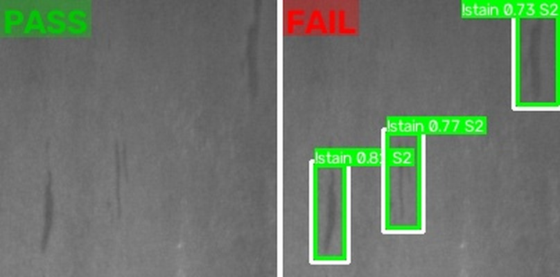
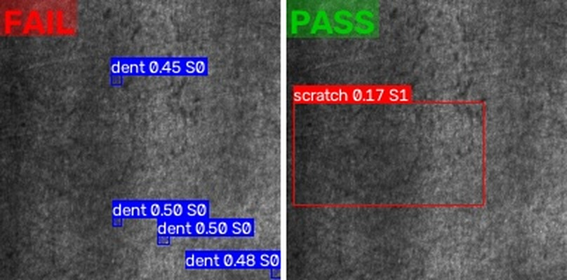
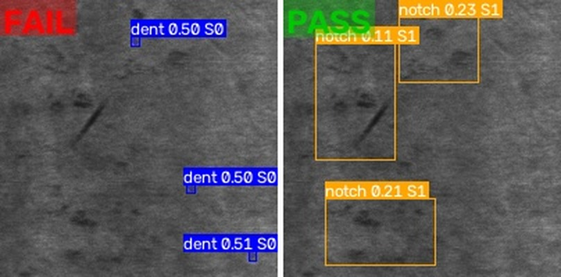
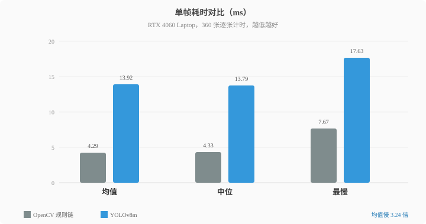

同一批 360 张 NEU-DET 验证图，两个检测器各跑一遍：传统 OpenCV 规则链和 YOLOv8m。结论先给：图像级检出 37.8% 对 99.4%，差距集中在“一个框都没给”的图上。这篇只比这一层，框得准不准另说。

## 一、OpenCV 靠四条规则判，YOLO 靠一份权重判

**OpenCV 把四类缺陷拆成四条规则链，每条靠几何或颜色阈值；YOLO 用一份 m 档权重对四类统一出框。**

四条链共用预处理：灰度、去噪、CLAHE 拉平光照。划痕靠顶帽/黑帽响应叠 Canny 边缘挑细长形状，凹坑靠 LoG 响应的圆度，污渍靠 Lab 色距与饱和度，缺口靠凸包缺陷深度。阈值共 18 个，全在 `configs/demo.yaml`。

OpenCV 的判据是参数，换光照或材质要重新标定；YOLO 的判据在 `best.pt` 里，换场景要回到训练。

## 二、360 张里，OpenCV 漏 224 张，YOLO 漏 2 张

**同一批图，差距落在“有没有框”这一层：OpenCV 有 224 张零检出，YOLO 只有 2 张。**

图像级检出只看一张图里有没有至少一条框过预筛：conf ≥ 0.25、面积 ≥ 10 px、框占比 ≤ 0.01。360 张跑完，OpenCV 检出 136 张（37.8%），YOLO 358 张（99.4%）。

左图 OpenCV，右图 YOLO。inclusion_206 上 OpenCV 一条框没给；crazing_19 和 rolled-in_scale_217 反过来，OpenCV 有框，YOLO 的最高 conf 只有 0.17 和 0.233，都没过 0.25。

OpenCV 的框都落在点状小区域，凹坑链路按圆度 0.6、半径 2–20 px 筛形状；YOLO 的框更大，crazing_19 上那条 scratch 横跨半张图。

## 三、漏得少的那一边，单帧慢了 3 倍

**OpenCV 均值 4.29 ms，YOLO 13.92 ms，前者快约 3 倍；中位和最慢的差距相近。**

上图耗时都是在 RTX 4060 Laptop 上测得。第一张只做预热，不计入；从第二张起逐张计 `detect()`，图里的均值、中位、最慢都来自这批单帧耗时。并且两边输入尺寸不同：YOLO 要先把图缩到 640×640 再推理，OpenCV 直接按原图尺寸算，3 倍差距里也含这部分计算量。

速度差对应维护方式：OpenCV 的 18 个阈值改 yaml 即可，YOLO 的判据改了要重新训练权重。

## 四、哪种缺陷交给 OpenCV，哪种交给 YOLO

**缺陷形态能枚举、材质稳定时，OpenCV 够用；跨材质、形态随批次变时，YOLO 的召回更稳。**

这套规则链在四类缺陷上覆盖到 37.8%，补一类形态就要加一条链或调一轮阈值；YOLO 用一份权重覆盖四类，代价是训练数据和 3 倍耗时。

## 附：360 张结果

| 指标 | OpenCV | YOLO(m) |
| --- | --- | --- |
| 图像级检出 | 136/360（37.8%） | 358/360（99.4%） |
| 零检出 | 224 | 0 |
| 总框数 | 350 | 1240 |
| 有效框 | 350 | 860 |
| 耗时均值 | 4.29 ms | 13.92 ms |
| 耗时中位 | 4.33 ms | 13.79 ms |
| 最慢 | 7.67 ms | 17.63 ms |

真要在产线上二选一，先拿目标批次的几十张图跑一遍：四类缺陷都能写成规则，OpenCV 够用且省事；出现落不进那 18 个阈值的新形态，就交给 YOLO。

两者也可以级联：OpenCV 先跑，检出缺陷的直接放行；它没检出的 224 张再送 YOLO 复核。召回能保住 YOLO 的水平，平均耗时低于纯 YOLO，OpenCV 独有的那 2 张也不会丢。

改完阈值或换权重后，跑 `scripts/eval_image_level.py --algo both` 可以重算上面这张表。

这些数字只覆盖图像级检出、单机 360 张、单次运行；像素级精度没测，换光照或相机后要重跑才能下结论。