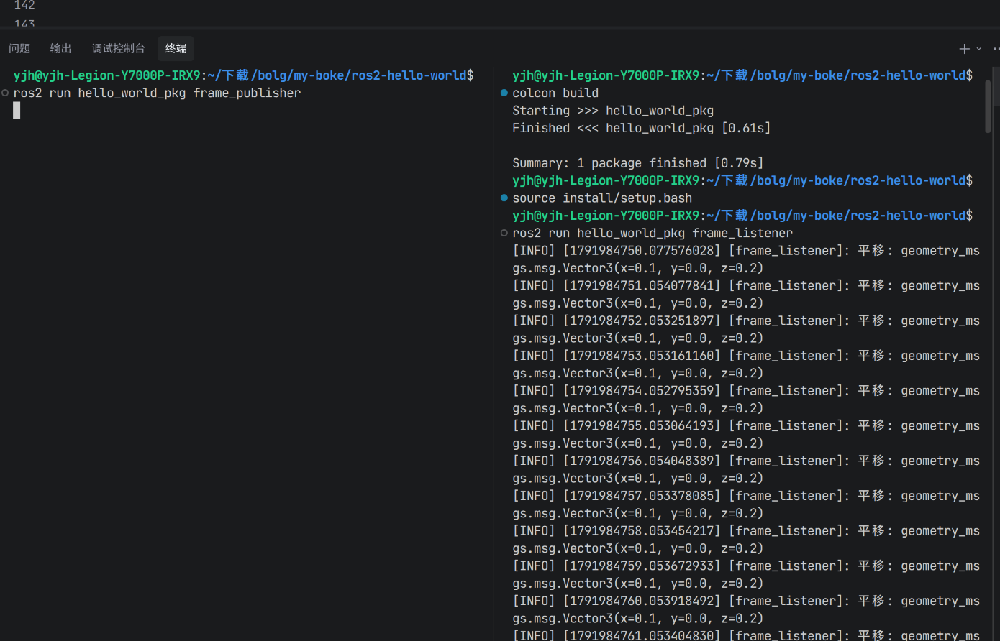
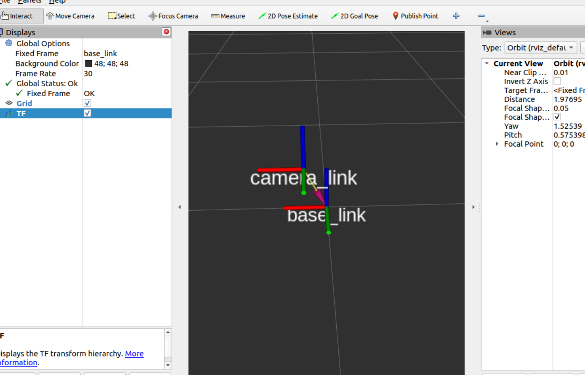
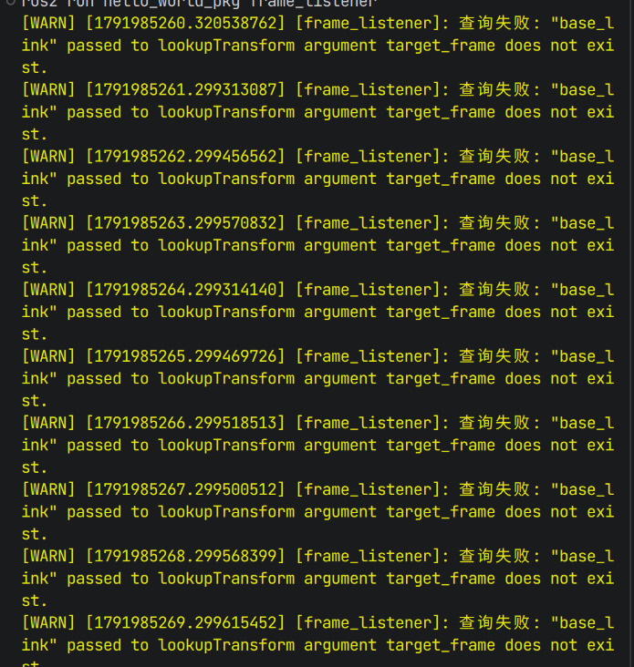
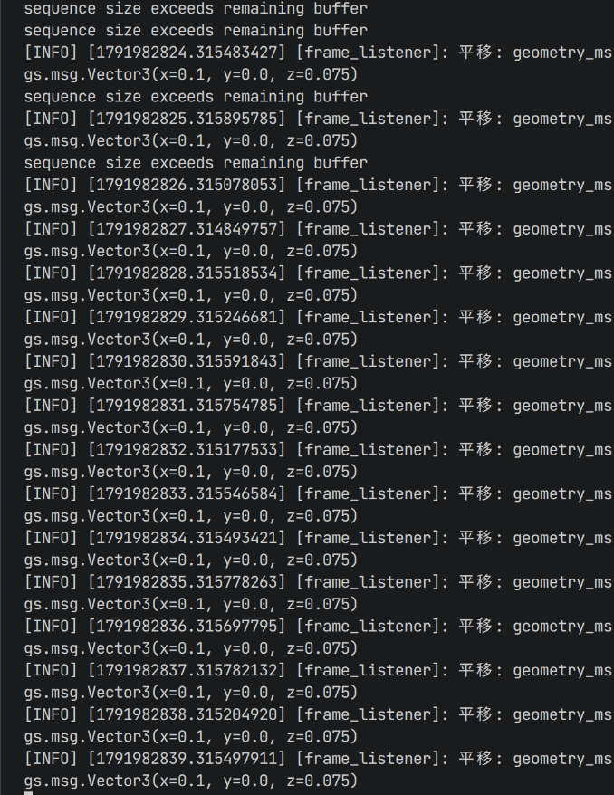

## 30 秒版

| | 普通 Python | ROS2 + TF2 |
|---|---|---|
| 描述位置 | `(x, y, z)` 一个元组 | 坐标 + **挂在哪个坐标系下** |
| 参照物 | 默认有个世界原点 | 坐标系树，每个部件一个坐标系 |
| 谁维护 | 你自己算 | TF2：广播变换 + 查询变换 |
| 典型坑 | 参照物没说清楚 | 树断裂、时间戳不匹配 |

一句话：**位置数据本身没有意义，"相对于谁"才有意义。** TF2 就是替机器人回答这个问题的。

---

前两篇写了 ROS2 代码为什么长得不一样（控制反转）、节点之间怎么说话（消息传递）。这篇写一个更根本的问题：**机器人怎么理解空间？**

## 普通 Python 的坐标观

```python
cup_position = (1.0, 2.0, 0.5)
print(f"杯子在 {cup_position}")
```

这行代码在普通 Python 里没问题。因为写代码的人脑子里**默认了一个参照系**——你的房间角落、屏幕左上角，随便什么，反正只有一个。

奶茶店翻译：有人说"奶茶在 3 号桌"。如果店里只有一张桌子，这句话没问题。但如果有十张桌子呢？"3 号桌"是相对于店门说的，还是相对于收银台说的？没有参照，位置就是空话。

机器人系统里这个问题更致命。相机说"杯子在 (0.5, 0.1, 0.3)"——机械臂听不懂。因为机械臂眼里的 (0.5, 0.1, 0.3) 是另一片完全不同的区域：相机装在头顶，机械臂长在底盘上，两者的"原点"差了半米，方向还可能不同。**每个传感器都活在自己的世界里。**

TF2 就是解决这个问题的。

> 名词说明：TF 是老版本的名字，TF2 是第二代。它早在 ROS1 的 Hydro 版（2013 年）就替代了 TF，ROS2 里只保留 TF2。现在大家嘴里说的"TF"指的就是 TF2，本文两个词混用。

## 坐标系树

ROS2 里，每个位置都必须挂在某个坐标系下。一台移动机器人常见的坐标系：

| 坐标系 | 含义 | 谁发布 |
|---|---|---|
| map | 世界原点，全局地图 | 定位系统 |
| odom | 里程计原点，连续但会漂移 | 轮式里程计 |
| base_link | 机器人本体中心 | 机器人模型 |
| camera_link | 相机安装位置 | URDF 或标定 |
| laser_link | 激光雷达安装位置 | URDF 或标定 |

> 表格里的几个专有词，生活版解释：
>
> - **里程计**：机器人的"计步器"——数轮子转了几圈，算出走了多远、转了多少。**里程计原点**就是开始数的那一点，也就是机器人开机那一刻站的位置。
> - **URDF**：描述机器人身体结构的文件——有哪几个部件、什么尺寸、彼此怎么连接。相当于家具的拼装说明书，ROS 读了它才知道相机装在身上哪个位置。
> - **标定**：没有说明书（URDF）时自己拿尺子量——相机在底盘上方几厘米、前方几厘米、歪了多少度，量出来的数填进代码。

这些坐标系组成一棵**树**：

```
map
└── odom
    └── base_link
        ├── camera_link
        ├── laser_link
        └── arm_base_link
            └── arm_tool_link
```

技术翻译：每个坐标系是树上的一个节点，坐标系之间的**变换**（平移 + 旋转）是连接节点的边。TF2 维护这棵树，并回答核心问题：**"A 坐标系下的一个点，在 B 坐标系下是哪里？"**

奶茶店翻译：每个员工有自己的"位置感"。点单员知道"3 号桌在我右手边"，后厨知道"3 号桌在出餐口左前方"——都没错，只是视角不同。TF2 是店里的空间地图，让所有人对"3 号桌在哪"有一份统一的账。

### 为什么要有 map 和 odom 两个？

这是 TF2 最反直觉的设计：定位为什么需要**两个**坐标系？

- **odom（里程计）**：靠数轮子转了多少圈推算位置。它**永远连续**——位置不会跳，但轮子一打滑就积累误差，越走越歪。
- **map（地图）**：定位系统拿传感器数据和地图比对得出的位置。它**准确**——但每次定位修正，机器人位置会瞬间跳一下。

两个都要，是因为机器人有两种需求：**底盘控制要平滑**（用 odom，不然位置一跳，控制器发疯）、**路径决策要准确**（用 map，不然漂移久了全错）。全用一个，另一种就崩。

简单来讲：odom 只管"走得稳"，不管"走得准"；map 只管"走得准"，不管"走得稳"。机器人脚下用 odom（保证连续不跳），脑子里用 map（保证不会越走越歪）——两者一结合，既能平滑走直线，又能最终走到对的地方。

## 广播变换：把"亲子关系"喊出去

告诉 TF2 两个坐标系之间的相对关系：

```python
import rclpy
from rclpy.node import Node
from tf2_ros import TransformBroadcaster
from geometry_msgs.msg import TransformStamped


class FramePublisher(Node):
    def __init__(self):
        super().__init__('frame_publisher')
        self.tf_broadcaster = TransformBroadcaster(self)
        self.create_timer(0.1, self.broadcast)

    def broadcast(self):
        t = TransformStamped()
        t.header.stamp = self.get_clock().now().to_msg()   # 盖时间戳：这条记录是什么时候量的
        t.header.frame_id = 'base_link'        # 父坐标系
        t.child_frame_id = 'camera_link'       # 子坐标系
        t.transform.translation.x = 0.1        # 相机在基座上方 20cm、前方 10cm
        t.transform.translation.y = 0.0
        t.transform.translation.z = 0.2
        t.transform.rotation.w = 1.0          # 没有旋转（单位四元数）
        self.tf_broadcaster.sendTransform(t)


def main():
    rclpy.init()
    rclpy.spin(FramePublisher())
```

逐行看关键的：

- `TransformStamped`：一条"亲子关系记录"——谁（`frame_id`）、谁的孩子（`child_frame_id`）、孩子站在父母的哪个位置（`translation` + `rotation`）、什么时候量的（`stamp`）
- `t.header.stamp = self.get_clock().now().to_msg()`：给记录盖时间戳——`get_clock().now()` 问 ROS2 拿当前时间，`.to_msg()` 把时间转成消息能携带的格式。这行前两篇没出现过，是本篇新面孔
- `create_timer(0.1, ...)`：每 0.1 秒广播一次。为什么要反复发？因为这个变换**可能变化**——相机装在云台上会转，机械臂关节会动。TF2 靠时间戳判断数据新鲜度，断了太久就报错
- `rotation.w = 1.0`：四元数表示"不旋转"。四元数是四个数（x, y, z, w）表示三维旋转的方式，(0, 0, 0, 1) 就是"没转"
- `TransformBroadcaster(self)` + `sendTransform(t)`：前者给节点装一个"广播器"，后者把 `t` 发出去。发到哪儿、和前两篇什么关系，"TF2 和前两篇的关系"一节揭晓

奶茶店翻译：店长在墙上贴了一张图——"收银台在店门正前方 2 米，出餐口在收银台左边 3 米"。这就是广播。



## 查询变换：问 TF2"它在我这儿的哪里"

```python
import rclpy
from rclpy.node import Node
from rclpy.time import Time
from tf2_ros import Buffer, TransformListener, TransformException


class FrameListener(Node):
    def __init__(self):
        super().__init__('frame_listener')
        self.tf_buffer = Buffer()
        self.tf_listener = TransformListener(self.tf_buffer, self)
        self.create_timer(1.0, self.query)

    def query(self):
        try:
            transform = self.tf_buffer.lookup_transform(
                'base_link',      # 目标坐标系：我要它在这下面的位置
                'camera_link',    # 源坐标系：数据原来挂在它下面
                Time()            # 零时间 = 最新可用的变换
            )
            self.get_logger().info(f'平移: {transform.transform.translation}')
        except TransformException as e:
            self.get_logger().warn(f'查询失败: {e}')


def main():
    rclpy.init()
    rclpy.spin(FrameListener())
```

几个容易踩的点：

- `lookup_transform(目标, 源, 时间)`：参数顺序是"**把源坐标系下的东西，换算到目标坐标系下**"。我总记成反的，报错查了半天
- `Time()` 零时间表示"拿最新的"，不是"零时刻"
- 返回值还是一个 `TransformStamped`——所以打印平移要写 `transform.transform.translation` 这种"套娃"：外层是消息本身，`.transform` 字段里才装着平移和旋转
- `TransformException` 是 TF2 的专用异常——别写 `except Exception`，太宽的捕获会把你自己代码的 bug 也吞掉（死锁无提示是 ROS2 里最阴险的坑，第二篇讲过）
- 查询的是**本地缓存**，不发请求。`TransformListener` 在后台订阅 `/tf` 话题，把收到的变换存进 `Buffer`，`lookup_transform` 查的是这份缓存——所以主程序里必须有 `rclpy.spin()`，executor 转起来 listener 才收得到数据

奶茶店翻译：新员工问店长"出餐口相对于收银台在哪"。店长不打电话问后厨（不发请求），翻出贴在墙上的图（本地缓存）回答："左边 3 米。"

## TF2 和前两篇的关系：没有第四种通信

看到这里你可能发现了——TF2 好像不是新东西？

对。**TF2 建立在话题之上**：

- `/tf` 和 `/tf_static` 就是两个普通话题
- broadcaster 就是一个 publisher，广播变换 = 发布话题
- listener 就是一个 subscriber + 一层缓存，查询 = 读缓存
- 第二篇讲的 QoS 在这里同样生效（`/tf` 是高频话题，但默认 QoS 是可靠传输、深度 100，不是 best_effort）

奶茶店翻译：TF2 用的还是对讲机（话题），只是对讲机里传的不是"订单"，是"位置信息"。

这是这个系列想培养的直觉：**ROS2 的知识点不是孤立的，新东西往往是旧东西的组合**。第一篇的回调、第二篇的话题，在 TF2 里全部生效。

## 实际用途：三个场景

**场景一：相机看到杯子，机械臂要抓**

相机检测到杯子，但它只知道杯子在 `camera_link` 下的位置。机械臂需要 `base_link` 下的位置才能算关节角度：

```python
from geometry_msgs.msg import PointStamped
from tf2_geometry_msgs import do_transform_point

# 相机说：杯子在我坐标系下 (0.5, 0.1, 0.3)
cup_in_camera = PointStamped()
cup_in_camera.header.frame_id = 'camera_link'
cup_in_camera.point.x = 0.5
cup_in_camera.point.y = 0.1
cup_in_camera.point.z = 0.3

# 查变换（camera_link 相对于 base_link）
transform = self.tf_buffer.lookup_transform('base_link', 'camera_link', Time())

# 转换：得到杯子在 base_link 下的位置
cup_in_base = do_transform_point(cup_in_camera, transform)
```

注意 `do_transform_point` 接收的是 `PointStamped` **消息**（带坐标系头的点），不是裸元组——裸元组它不知道"相对于谁"，转了也白转。

奶茶店翻译：后厨从出餐口的小窗口看到"3 号桌的奶茶好了"，但点单员需要"3 号桌在哪"。TF2 负责把"出餐口视角"换算成"点单员视角"。

**场景二：激光雷达看到障碍物**

激光雷达在 `laser_link` 下测到"前方 1.2 米有障碍物"。导航系统需要它换算到 `base_link` 下才能决定往哪躲——雷达装在车头，"前方 1.2 米"不等于"机器人中心前方 1.2 米"。

**场景三：机械臂抓取**

机械臂末端是 `arm_tool_link`，目标物体在 `camera_link` 下。抓取规划要把目标换到 `arm_base_link` 下，才能反解出各关节转多少度。

三个场景是同一件事：**换算视角**。



## 常见错误

**错误一：坐标系树断裂**

`map → odom → base_link` 中间某个环节没人发布，下游所有查询永远失败。TF2 要求树**必须连通**，断一环全断。

检查方法：

```bash
ros2 run tf2_tools view_frames
```

生成 PDF，看树是不是完整的。



**错误二：静态变换用动态广播**

相机装在机器人上，拧螺丝拧死了——这个变换**永远不变**。用 `TransformBroadcaster` 每 0.1 秒发一遍，浪费带宽；更麻烦的是 `/tf` 不锁存——比 broadcaster 晚启动的节点根本收不到这条变换。该用 `StaticTransformBroadcaster`：它发到 `/tf_static`，锁存式 QoS，发一次，任何时刻启动的节点都能收到：

```python
from tf2_ros import StaticTransformBroadcaster
self.static_broadcaster = StaticTransformBroadcaster(self)
self.static_broadcaster.sendTransform(t)   # 不需要定时器
```

**错误三：时间戳不匹配**

查询时给的时刻和缓存里数据的时刻对不上，报 `ExtrapolationException`（外推异常）。`Time()` 拿最新没问题；但处理传感器数据时，要用**消息自己的时间戳**（`msg.header.stamp`）去查——"这条数据采集的时刻，变换是什么"，而不是"现在的变换"。

**错误四：收到来路不明的数据**

这是我写这篇时真实踩到的坑。跑通 broadcaster + listener 之后，我把自己的 broadcaster 停了，listener 居然还在打印查询成功——而且打印的平移是 `z=0.075`，我代码里写的明明是 `z=0.2`。

原因：ROS2 靠 DDS 在局域网上**自动发现节点**，默认所有人都在同一个频道（`ROS_DOMAIN_ID=0`）。同一网络里别人的节点在广播同名坐标系的变换，我的 listener 照单全收。终端里还夹杂着 `sequence size exceeds remaining buffer` 刷屏——那是收到的消息版本对不上、解析失败的报错，也是"网络里有别人"的线索。

解决：给自己划一个独立频道，每个终端跑节点前先设置：

```bash
export ROS_DOMAIN_ID=42    # 0~101 之间挑一个不大众的数
```

或者干脆只和本机通信：`export ROS_LOCALHOST_ONLY=1`。



## 学习者的启示

- 看到位置数据，先问：**在哪个坐标系下？**
- 看到多个传感器，先问：**它们的坐标系怎么连起来？**
- 看到 `header.frame_id`，先问：**填对了吗？**
- 看到查询失败，先问：**树完整吗？时间戳对吗？**
- 看到数据和代码对不上，先问：**这是我发的吗？**（局域网里可能有别人，错误四）

## 结尾

TF2 是机器人系统的"空间语言"。没有它，相机、激光雷达、机械臂各说各话；有了它，所有传感器数据才能统一到同一个坐标系下——"杯子在 (0.5, 0.1, 0.3)"才终于有了完整的含义。

奶茶店类比能帮你理解坐标系树和视角换算，但它帮不到你四元数旋转、变换插值、时间同步这些细节——那些是另一层东西，需要另找资料。

下一篇按课程进度写仿真：机器人怎么在假世界里练习走路。

如果文中有理解错误的地方，欢迎指出。

## 环境信息

- Ubuntu 22.04
- ROS2 Humble
- Python 3.10
- 完整代码：[本仓库 ros2-hello-world/ 目录](https://github.com/wbxxmz/my-boke/tree/main/ros2-hello-world)
