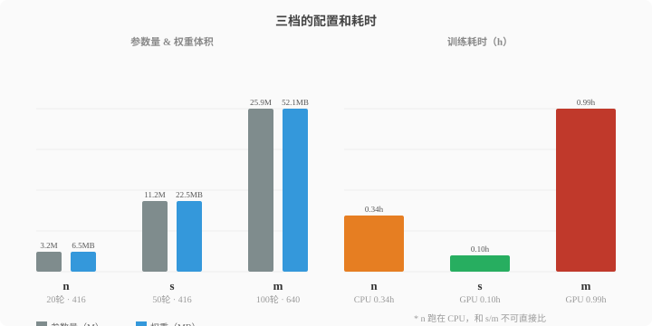
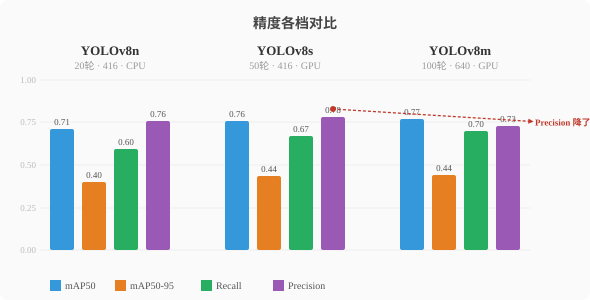
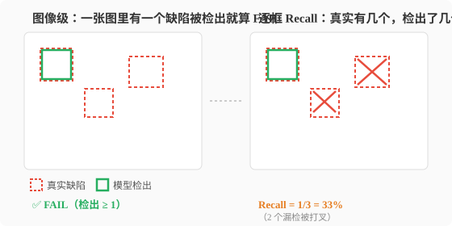

这篇只回答一个问题：NEU-DET 上 n、s、m 三档选哪个。答案先给：默认 m；s 是体积受限时的备选；n 暂时不推荐。三档的配置没有固定对照，所以下面的数字只能排序，不能归因。

## 一、配置差异：三次训练到底差在哪

三次训练用同一份数据：NEU-DET，原生 6 类合并成项目契约的 4 类，训练 1440 张、验证 360 张，8:2 分层切分,差别全在配置。

图里几个词先说清楚：参数量是模型里可训练数字的个数，M 指百万；权重体积是训练完存成 `.pt` 文件的大小；训练耗时是跑完全部轮数用的时间。

左半边从 n 到 m，参数量和权重都变成原来的 8 倍：n 的权重 6.5 MB，m 52.1 MB，手机里装一个 m 等于装八个 n。

右半边是耗时：n 0.34 h、s 0.10 h、m 0.99 h。三档的设备和轮数都不同，不能直接比快慢，只能当成本参考。

完整配置在表里，图只画了参数量、权重和耗时：

| 项目 | YOLOv8n | YOLOv8s | YOLOv8m |
| --- | --- | --- | --- |
| 参数量 | 3.2 M | 11.2 M | 25.9 M |
| 权重体积 | 6.5 MB | 22.5 MB | 52.1 MB |
| 训练设备 | CPU | RTX 4060 | RTX 4060 |
| 训练轮数 | 20 | 50 | 100 |
| 输入分辨率 | 416 | 416 | 640 |
| 批大小 | 8 | 16 | 8 |
| 训练耗时 | 0.342 h | 0.100 h | 0.989 h |

**综合来看，m 整体更好**：精度最高，代价是 8 倍体积和最长的训练时间。但这五项配置一起变，没有固定参照，所以只能说三档整体上 m 更好，说不了“骨干规模单独贡献了多少精度”。

## 二、精度：多出来的容量买到了什么

这一节回答：从 n 换到 s、再换到 m，精度各涨了多少，代价是什么？

Precision 是框出来的里面有多少是真的：报警 10 次，几次真有事。Recall 是真实缺陷里抓到多少：现场 10 个，抓回几个。两个必须一起看：乱框能刷高 Recall，只框一处能刷高 Precision。

mAP50 是把两者合起来的总分，越高说明框得又全又准；它的门槛是框住一半就算对。mAP50-95 把门槛提到几乎严丝合缝，框歪一点就不算，分数自然更低。

**m 的精度整体最好，多出来的容量买的是召回**：mAP50 和 Recall 三档最高，Precision 却从 s 的 0.7825 掉到 0.7270。项目更怕漏检，宁愿多报：每 100 个真缺陷，n 漏 40 个，m 漏 30 个。

完整数字在表里：

| 指标 | YOLOv8n | YOLOv8s | YOLOv8m |
| --- | --- | --- | --- |
| Precision | 0.7588 | 0.7825 | 0.7270 |
| Recall | 0.5955 | 0.6713 | 0.6989 |
| mAP50 | 0.7109 | 0.7579 | 0.7693 |
| mAP50-95 | 0.4003 | 0.4354 | 0.4411 |

表里是训练结束那次验证写进日志的数，不是末轮权重；今天用同一个 `best.pt` 重跑两遍，mAP50 差千分之一（0.7699 对 0.7693），GPU 浮点运算不完全可复现，不影响结论。

## 三、漏检的两种口径：整张图，还是每个缺陷

这一节回答：同一批 360 张图，为什么检出率能到 99.4%，Recall 却只有 0.6989？

图像级只问一件事：这张图里有没有检出至少一条有效缺陷，有就算检出。逐框指标问的是每个真实缺陷有没有被框住，分母不同，所以 99.4% 和 Recall 0.6989 能同时成立：一张图里有几个缺陷，检出一个，这张图就算检出。

左图：一张图里检出至少一个缺陷就判 FAIL，算这张图检出；右图：三个真实缺陷只框住一个。

最早评估只用了 30 张分层抽样，`best.pt` 跑出 30/30。我觉得模型挺好，但也知道百分百不可能，大概率是因为30 张太少。我想加大训练集重训，但翻下来本地只有 1800 张。只能换评估集,全量 360 张 val 重跑，得到 358/360，图像级 **99.4%**。100% 自己就被打破了。

判定规则没改动：`max_count=0`、`max_area_ratio=0.01`、`min_confidence=0.25`、`min_area_px=10`，任何一条框通过预筛就判 FAIL。

它直接决定图像级检出率：360 张里 358 张被判检出（FAIL），**99.4%** 就是 358/360；剩下 2 张最高 conf 是 0.17 和 0.233，低于 0.25，没判出缺陷。

逐框指标把同一批 360 张拆成 860 个有效框，其中只有 0.6989 被框住；漏掉的那些，只要同图还有一条框检出，图像级仍然算检出。358/360 和 0.6989 说的是同一批图的两个层次。

**所以 99.4% 回答的是“有没有发现”，0.6989 回答的是“找全了没有”，两个数不矛盾。**

## 四、三档选型：什么时候用 m，什么时候考虑 s 或 n

这一节回答：现在默认用哪一档，换档要付什么代价？

**现在默认用 m。只有部署端卡体积时才退到 s；n 暂时不推荐，精度最低，速度和图像级检出率又都没实测。**

s 的卖点是体积：权重 22.5 MB，不到 m 的一半，mAP50 0.7579 只比 m 低一点。换不换，取决于部署端卡不卡这几十 MB。

n 只有 6.5 MB、3.2 M 参数，但 Recall 0.5955 是三档最低；它现在只能算“更小”的选项，还算不上“更快”，因为速度没测。

切换只改配置：模型路径、输入尺寸、设备三个字段换成对应值，代码不用动。

| 方案 | 实测数据 | 未留存 |
| --- | --- | --- |
| 现在用 m：100 轮 / 640 / batch 8 | mAP50 0.7693、Recall 0.6989、图像级 99.4%、单帧 13.92 / 13.79 / 17.63 ms（GPU）、权重 52.1 MB、参数量 25.9 M、训练 0.989 h、显存 3.26 GB | 无 |
| 换 s：50 轮 / 416 / batch 16 | mAP50 0.7579、Recall 0.6713、权重 22.5 MB、参数量 11.2 M、训练 0.100 h | 图像级检出率、单帧推理耗时 |
| 换 n：20 轮 / 416 / batch 8 | mAP50 0.7109、Recall 0.5955、权重 6.5 MB、参数量 3.2 M、训练 0.342 h | 图像级检出率、单帧推理耗时 |

最后因为缺少s 和 n 在同一批 360 张 val 上的 GPU 推理耗时、图像级检出率,换档值只停在推测。
